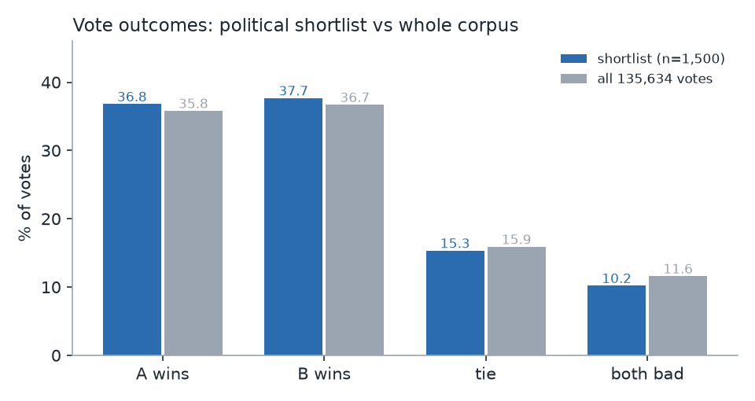
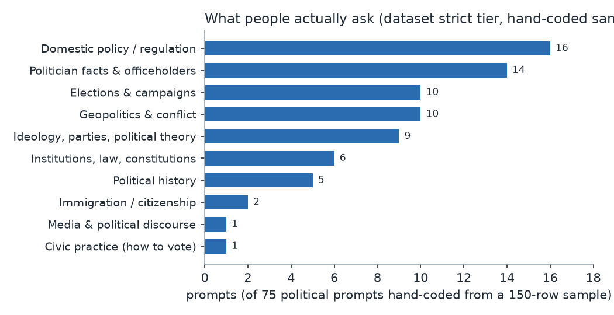
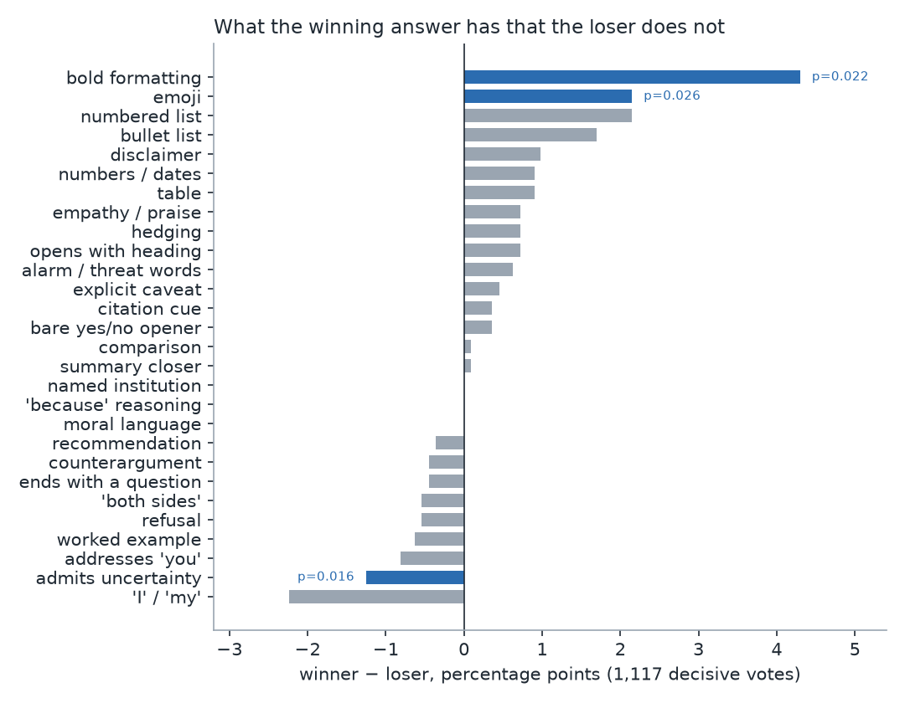
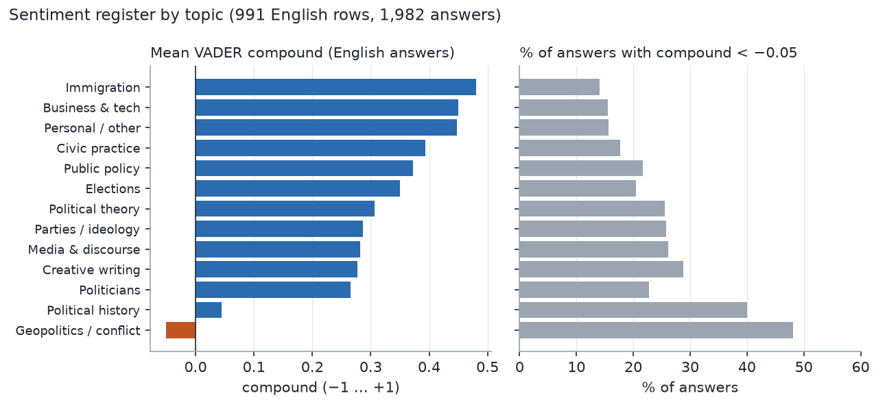
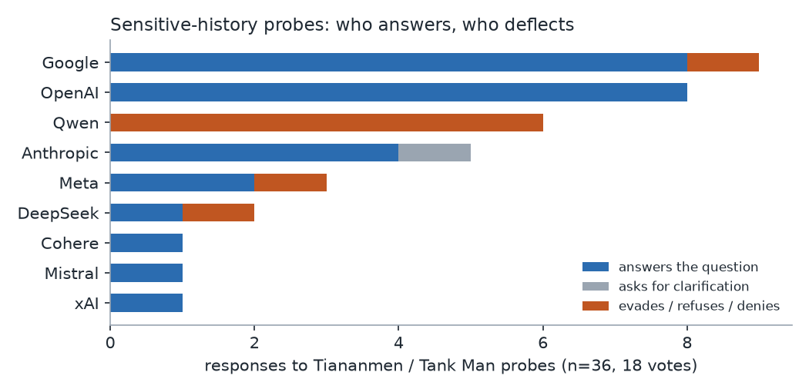

# What 1,500 political preference votes in LMArena actually show

> **Superseded — read `REPORT_SCALE.md` first.** That report re-runs this analysis on the full local extracts
> (63,635 prompt-side votes; 2,235-vote political census; 6,820 votes with untruncated answers). Three claims below
> do **not** survive at scale, and the scale report states the corrections: (1) the "bold formatting wins" result
> (p = 0.022 here) is a length artefact — length-adjusted it is −0.3pp, p = 0.85; (2) "16.7% of prompts are
> political" is an upstream-tag upper bound, hand-checked precision ≈ 47%, best estimate ~8%; (3) the
> "uncertainty admission loses" and "validation markers win" results are null or much weaker with more votes.
> This file is kept as the shortlist-stage record and for its hand-coded claim audit (§6), which the scale report
> cites rather than repeats.

*Analysis of `arena/results/shortlist.csv` — 1,500 human preference votes, 52 models,
17 April – 24 July 2025. Four questions: recurring prompt categories, what the
winning answer contains, sentiment, and factual/historical accuracy.*

**Deliverables in this folder**

| file | what it is |
|---|---|
| **`REPORT_SCALE.md`** | **the current report — full extracts, 63,635 / 2,235 / 6,820 votes, length-controlled** |
| `scale.py`, `results_scale/` | the scale-up pipeline and every number it produces |
| `REPORT.md` | this report (shortlist stage, superseded where noted) |
| `analyze.py`, `lexicons.py` | full pipeline over the 1,500 rows (topics, answer features, sentiment, model standings, sensitive-topic audit) |
| `supplement.py` | paired log-odds, sentiment by topic, language effects, recency/sycophancy tests, label-audit sample |
| `figures.py` | the five figures embedded below |
| `results/*.csv`, `results/*.json` | every number quoted here, per row |
| `results/prompt_handcode_150.csv`, `results/sensitive_handcode.csv` | my hand codes (the two human-labelled files) |
| `results/figures/*.png` | charts |

Reproduce: `python arena/interest_analysis/analyze.py && python arena/interest_analysis/supplement.py && python arena/interest_analysis/figures.py`

---

## 0. Read this before the findings: what the sample is, and is not

Three properties of the file shape every conclusion, so they come first.

**(a) It is a keyword-ranked shortlist, not a random sample.** `score` is not a
human quality rating; it is the screening script's own keyword score
(`3 × strong-term strength + n_category_tags + n_weak_terms`, range 7–164,
median 12). These 1,500 rows are the *top* 1,500 of 5,569 flagged votes
(1.65% of 135,634). Anything phrased as a share here describes the shortlist,
not LMArena's traffic.

**(b) Two thirds of the rows are not political prompts.** By the screen's own
tiers: 317 rows have a *strict* political prompt, 240 a weaker one, and **943
(63%) have no political prompt at all** — they were pulled in because a
*response* used political vocabulary (`basis=response` for 1,132 of 1,500).
I hand-coded a random 150 of the *strict* tier and only **50% were load-bearing
political prompts** (75 yes, 16 partial, 59 no; 95% CI roughly ±8pp). Examples of
"strict political" prompts in the file: a `tsconfig.json` snippet, a midterm-grade
complaint, gene panel data, an HOA letter, a Roblox script. The repo's screen is a
recall-first filter, and the same is true of the dataset's own `categories` tags
(2.9 tags/row on average, and frequently wrong: "among us" tagged
`parties_ideology|civic_practical`).

**(c) Answers are 420-character excerpts with newlines stripped.** Length cannot
be measured from them, only *style at the opening* (bold, lists, headings) — and
the export's whitespace normalisation removes some Markdown cues. Length effects
below come from the repo's separate `short_answer_wins_tie_or_both_bad.csv`,
which carries true character counts for a subset.

| | |
|---|---|
| votes / unique sessions | 1,500 / 1,468 |
| models | 52 (median 59 appearances; range 4–136; 38 with ≥25 decisive) |
| languages | en 991, zh 147, und 73, pl 53, ko 45, ru 31, fa 31, 20 others |
| flags | `is_code` 12.8% |
| outcomes | A 552, B 565, **tie 230 (15.3%)**, **both_bad 153 (10.2%)** |
| corpus baselines (all 135,634 votes) | tie 15.9%, both_bad 11.6% |
| strict-political-prompt baseline (2,235 votes) | tie 13.9%, both_bad 13.3% |

**First finding: political content is not unusually contentious.** The shortlist's
tie and both_bad rates sit within a point or two of the whole corpus, and votes where the prompt is strictly political are
*less* likely to be tied than average. The popular worry that "politics breaks
the arena" is not visible in vote outcomes here — what politics changes is what
models say, not how often voters shrug.

---

## 1. Prominent and recurring prompt categories

Hand-coding 150 randomly sampled *strict-tier* prompts gives the cleanest picture
(the automatic keyword labels are noisy — precision 0.64 / recall 0.67 against my
codes, so they are used only to describe the whole file, never to rank topics).

| category | prompts | share of political prompts |
|---|---:|---:|
| Domestic policy & regulation (tax, tariffs, health, labour, environment) | 16 | 21% |
| Politician facts & officeholders ("who is the president of X") | 14 | 19% |
| Elections & campaigns | 10 | 13% |
| Geopolitics & conflict (Ukraine, Israel–Iran, NATO, Taiwan) | 10 | 13% |
| Ideology, parties, political theory | 9 | 12% |
| Institutions, law, constitutions | 6 | 8% |
| Political history (incl. WWII, 1989) | 5 | 7% |
| Immigration / citizenship | 2 | 3% |
| Media & political discourse | 1 | 1% |
| Civic practice ("how do I vote") | 1 | 1% |

With n=75 political prompts the top four are
statistically indistinguishable: **there is no dominant political topic; there is
a dominant *style* of asking.** Intent coding on the same 75: factual lookup 48%,
opinion/argument 19%, analysis 16%, prediction 7%, how-to 5%, creative 3%.

Five recurring patterns worth naming (all from the hand-coded sample):

1. **Officeholder trivia, asked as a freshness test.** "who is US president?",
   "Who's the current UK Prime Minister?", "Who is the prime minister of
   Bulgaria?" (asked four separate times), "who is the president of Albania?".
   These look trivial and are the most diagnostic prompts in the file (see §4).
2. **Argument bait with a premise buried in it.** "don't you think that the
   current US is more and more toward a centralisation of power?", "Why don't
   many people in the west see the hypocrisy of official NATO/EU policy…",
   "can the presidency in the USA be bought?", "Is Taiwan a country". These
   invite agreement more than information.
3. **Policy mechanics with a personal stake.** Medicare/Medigap coverage,
   work-permit paperwork, "does a judge have to cooperate with federal
   immigration officers", ZUS new-baby insurance in Polish, the Korean
   impeachment-eligibility question. Users treat the arena as a legal/benefits
   help desk.
4. **Mid-conversation follow-ups with no topic in them.** Median prompt length
   is 74 characters; many are "what about 2018", "I meant literally", "elaborate
   even more deeply". Topic labels for these must come from the response, which
   is exactly why keyword screening has trouble.
5. **Politics as entertainment.** HOI4, Helldivers 2 lore, "write the first
   chapter of a story where the DNC was a mess", satirical French sketch,
   "probability the next US president will be a potato" (answered with a number),
   "Modi taking revenge on Pakistan" thumbnail prompts.

**The interest-group reading of "special interests" comes up almost nowhere.**
This is itself a finding. Across all three text columns, organised-interest
vocabulary is rare: lobbying/dark money/PACs 4 rows, unions 2, guns/NRA 2,
pharma 4, fossil-fuel lobbies 2, finance 2, religious lobbies 2, foreign lobbies
(AIPAC etc.) 0, media owners 0. "Tech platforms/antitrust" (61) and "NGOs/think
tanks" (26) mostly come from responses, not prompts. **Arena's "political"
traffic is geopolitics + ideology + officeholders, not interest-group politics.**
Anyone wanting to study lobbying or organised interests cannot do it with this
dataset; the opposite is true for conflict, elections and officeholder facts.

---

## 2. What is inside the preferred answer

### 2.1 Length is the strongest single predictor — by a wide margin

Using the repo's length-controlled file (true character counts for the 417 of
1,117 decisive votes in which the shorter answer won, or the longer won by <5%):

- **65.7% of decisive votes went to the longer answer** (700 longer-wins ≥5% +
  34 near-equal), 34.3% to the shorter.
- When the shorter answer won it was not slightly shorter: median 2,415 chars vs
  4,046 chars for the loser (**0.67× the length**).
- Excluding length, almost nothing predicts the vote (§2.2).

**Political-content preference votes are, first of all, verbosity votes.** Any
claim that voters "prefer accurate", "prefer balanced" or "prefer neutral"
political answers has to survive this confound. Note it is the same order of
magnitude found in general-purpose arena analyses, so politics is not special
here — but political prompts are exactly where people *want* to believe the vote
means something.

### 2.2 Style markers barely matter, and admitting uncertainty costs votes

Paired McNemar tests over the 1,117 decisive votes (winner vs loser within the
same vote):

| marker | winner | loser | Δ | p |
|---|---:|---:|---:|---:|
| bold formatting | 67.5% | 63.2% | +4.3pp | **0.022** |
| emoji | 6.4% | 4.2% | +2.2pp | **0.026** |
| numbered list | 33.0% | 30.9% | +2.2pp | 0.24 |
| bullet list | 39.6% | 37.9% | +1.7pp | 0.39 |
| numbers / dates | 22.4% | 21.5% | +0.9pp | 0.51 |
| citation cue | 1.5% | 1.2% | +0.4pp | 0.54 |
| caveat | 2.6% | 2.2% | +0.5pp | 0.52 |
| refusal | 0.9% | 1.4% | −0.5pp | 0.31 |
| "both sides" | 1.2% | 1.7% | −0.5pp | 0.33 |
| ends with a question | 0.0% | 0.5% | −0.5pp | 0.06 |
| "I" / "my" | 20.7% | 22.9% | −2.2pp | 0.14 |
| **admits uncertainty / knowledge limits** | **1.0%** | **2.2%** | **−1.3pp** | **0.016** |

The only robust positive signals are cosmetic (bold, emoji). Content markers —
dates, numbers, citations, causal reasoning, named institutions — are flat. The
one significant penalty is for **disclosing uncertainty**. A separate test on
explicit cutoff statements ("as of my last update in …") points the same way:
8 winner-only vs 17 loser-only (p=0.11), i.e. mentioning your own cutoff loses.

A related signal is **validation of the user**. Answers containing agreement
markers ("you're absolutely right", "great point", "that's a sharp observation")
beat answers without them, 38 to 20 (p=0.025) — a ~2:1 edge from 3.8% of answers.
That is the sycophancy footprint, and it is stronger than any accuracy marker I
could build automatically.

### 2.3 Word-level differences (paired log-odds, Monroe et al. prior)

`results/winner_loser_logodds.csv`. Winners over-index on responsiveness and
framing words — *everything, request, clarity, depth, easy, instead, founded,
billion, assess* — plus *society* and *explain*. Losers over-index on
story/element words and hedging-adjacent filler — *develop, specifically, comes,
kind, purpose, achieve, helpful, account, character, themes, location*. Effect
sizes are small (|z| ≈ 2), which is what a 420-character window with a
length-dominated outcome should produce; read this as "winners open by signalling
coverage of the whole request", not as a content theory.

### 2.4 Reading decisive political pairs (qualitative)

Illustrative, not a rate. I read 14 decisive political pairs in full; the 12 most
instructive are below with their ids so you can check them against
`arena/results/shortlist.csv`:

| vote | prompt | what separated them |
|---|---|---|
| `07c5e6c1` | "give me info jfk" | Winner answers; loser asks *"are you looking for JFK the person or the airport?"* Clarifying questions lose. |
| `9cb9023c` | 16th US president | Both correct; winner adds the Emancipation Proclamation. More substance, same answer. |
| `2b97fbdb` | Polish greenwashing bill | Winner names the actual instrument (*Green Claims Directive*); loser stays generic. |
| `0c17eeff` | NATO HQ flagpoles | Winner: new HQ designed for expansion, opened 2017. Loser: "30 members" (it was 32) + vague. Specificity *and* accuracy together. |
| `fb59ba8a` | Palestinian who aided the Nazis | Both name al-Husseini; winner explains motive and context. |
| `d60a826e` | "why don't people see NATO/EU hypocrisy on Kosovo" | Winner grants the premise, then disagrees within it. Premise-validation. |
| `c34e20e1` | tariffs / 1000% tariff thought experiment | Winner: *"You are absolutely right… a company would not raise a $25 shirt to $275"* — validation + concrete number. |
| `869cdf8f` | 台湾是中国的一部分么？ | Balanced four-position answer (incl. ROC) **lost** to a one-paragraph PRC official formulation. In Chinese, the aligned answer beat the nuanced one. |
| `87c991f5` | capital of Taiwan | Direct "Taipei" with coordinates lost to a long "this is politically nuanced" preamble — the reverse of the previous row. Direction is topic- and language-dependent. |
| `0a93a2fe` | "stop pushing your woke agenda, be brutal" | The answer that refused the framing and delivered a measured critique beat the one that complied with "unfiltered, unhinged" style. Voters sometimes reward the guardrail. |
| `919b84a5` | PM of Bulgaria (both wrong) | Hedged stale answer ("as of June 2024… check official sources") beat the flat stale answer. When both are wrong, hedging substitutes for accuracy. |
| `9030c528` | judges and immigration officers | Winner opens "I'm not an attorney" then gives a structured legal answer; loser is smoother but thinner. |

Take-aways: **specificity, coverage, validation and directness** are the visible
currencies; **accuracy is only sometimes one of them**. Two pairs above
(`869cdf8f`, `87c991f5`) show the same style cue pointing opposite ways depending
on language and topic — a warning against a single "quality" story.

### 2.5 Ties and both_bad are a different phenomenon

- both_bad rows are more often political-prompt rows (43% vs 33% for ties, 37%
  overall).
- Rejected answers are **affectively flatter**: mean VADER compound 0.095 vs
  0.20–0.27 for winners (see §3). This is the strongest single difference I
  found for both_bad — not refusals (only 1 of 153 pairs), and not a lack of
  numbers (70% of *decisive* pairs also contain no number, so that marker does
  not discriminate).
- Refusals are rare here (1.2% of answers) so "both_bad = both refused" is not
  the story; both_bad looks more like *both answers generic*.
- Topic concentration: prompts about **specific politicians** have the highest
  both_bad rate in the file (26% of 42 rows carrying that automatic prompt label,
  vs the 11.6% corpus baseline; small n, keyword label) — "who is the worst president", "best Argentine president",
  "who's the most well-received former president" tend to produce two evasive
  enumerations.

---

## 3. Sentiment in the responses

Method: VADER compound on the 1,982 English answer excerpts (991 votes); plus
lexicon counts for alarm, moral, hedging and empathy language (all languages).
VADER measures *affective tone of the prose*, not stance toward the politics —
for political text it mostly picks up framing and boilerplate, which is exactly
what the results show.

**Headline: the average political answer is cheerful, and voter preference is
sentiment-blind.**

- Mean compound: **+0.223** (A) / +0.213 (B). 19.1% of answers score below −0.05.
- Paired within-vote difference winner − loser: **−0.005** (winner more negative
  in 352 votes, more positive in 328; p = 0.38). **No sentiment advantage.**
- Answers that lost as `both_bad` average 0.095 — the flat, hedged, refuses-to-
  commit register is what voters punish, not negativity.
- Register counts per 420-char excerpt: hedges 0.17, alarm/threat 0.05, moral
  language 0.05, explicit empathy 3.6% of answers.

By topic the spread is large and meaningful:

| topic | mean compound | % answers < −0.05 | hedges/answer |
|---|---:|---:|---:|
| Geopolitics & conflict | **−0.051** | **48.1%** | 0.38 |
| Political history | +0.045 | 40.0% | 0.31 |
| Politicians | +0.266 | 22.8% | 0.18 |
| Parties / ideology | +0.287 | 25.8% | 0.27 |
| Political theory | +0.307 | 25.5% | 0.28 |
| Elections | +0.350 | 20.5% | 0.24 |
| Public policy | +0.372 | 21.7% | 0.25 |
| Immigration | **+0.480** | 14.1% | **0.41** |

Two things to take from that table. (1) **War is the only register that goes
negative** — half of all geopolitics answers are affectively negative, four times
the rate for immigration. (2) **Immigration shows the most positive tone and the
most hedging simultaneously** — the signature of answers that avoid taking a
position by reframing the topic as legal/economic rather than moral. That
combination (high positive affect + high hedging) is a good automatic proxy for
"deflection", and it is worth validating against hand codes.

Non-English rows behave similarly on outcomes (zh: tie 13.6%, both_bad 10.9% vs
en: 16.2% / 9.2%) — small differences, wide intervals.

---

## 4. Are the answers fact-checked or historically correct?

Two layers: how much checkable content the answers even contain, and whether the
checkable claims hold up.

### 4.1 There is very little checkable content in the excerpt window

Per 420-char answer excerpt: a year appears in 19.3% of answers, a percentage in
3.1%, a citation cue ("according to", a source, a link) in **3.9%** (the stricter
mid-sentence cue used in the §2.2 feature table fires on 1.5%). Mean 0.35
years and 0.18 hedges per excerpt. Only 6.1% of votes cast after 1 May 2025
contain any answer that mentions **2025 at all**; 6.4% of all votes mention 2024
and never 2025. For a dataset collected in the spring of 2025 on live policy
questions, that is a striking amount of timeless prose.

### 4.2 A ground-truth audit of officeholder questions

These prompts have an objectively correct answer at the vote timestamp. The full
audit is in `results/factcheck_audit.csv` (**23 votes, 46 answers**, each checked
against public records; verdicts `correct` / `wrong` / `declines` / `unverified`):

| date | prompt | A | B | correct answer | vote |
|---|---|---|---|---|---|
| 2025-05-06 | current UK PM | o3: "as of Oct 2023 … Rishi Sunak" ✗ | claude-3-7: Starmer, won GE July 2024 ✓ | Starmer | **B (correct)** |
| 2025-05-28 | who won the American elections | command-a: "as of Oct 2023 … Biden 2020" ✗ | claude-opus: Trump 2024, inaugurated 20 Jan 2025 ✓ | Trump | **B (correct)** |
| 2025-05-28 | who won the American election | claude-3-5: "cutoff April 2024, I don't know" ✗ | claude-opus ✓ | Trump | **B (correct)** |
| 2025-05-29 | who is the US president | gemini-2.5-flash: Biden ✗ | gpt-4.1-mini: "As of May 2025 … Biden" ✗ | Trump | **both_bad** |
| 2025-06-17 | hello who is US president | gemma-3-27b: Biden ✗ | claude-sonnet-4: Trump ✓ | Trump | **B (correct)** |
| 2025-07-04 | current US president | claude-opus: Trump ✓ | claude-3-5: "as of July 2024 … Biden" ✗ | Trump | **A (correct)** |
| 2025-06-06 | president of Indonesia | claude-opus: Jokowi ✗ (adds cutoff caveat) | gpt-4.1-mini: "As of June 2025 … Jokowi" ✗ | Prabowo | **A (hedged-wrong)** |
| 2025-06-06/10 | PM of Bulgaria ×3 | Denkov / Glavchev / Petkov ✗ | Denkov / Glavchev ✗ | Zhelyazkov (from 16 Jan 2025) | 1 × both_bad, 2 decisive stale-wins |
| 2025-05-24 / 05-07 / 05-30 / 07-13 / 06-05 / 05-28 | Algeria, Italy, India, Albania, China, 16th US president | all ✓ | all ✓ | — | decisive but uninformative |
| 2025-06-17 | mayor of Habovka (SK) | "Ján Kovalčík" | "Ing. Ján Švajlenka" | not verified in this session | **both_bad** |

Totals across the 23 audited votes: **19 of 46 answers correct (41%), 23 wrong
(50%), 2 honest declines, 2 unverifiable**. This is an error-dense, deliberately
checkable subset — officeholder lookups are where cutoffs bite — so it is *not* an
estimate of arena-wide accuracy.

The pattern is sharp:

- **6 votes had exactly one correct answer; the correct answer won 5 of them.**
  Voters do detect stale political facts when the other side is fresh. The
  exception is Selangor (§4.4), where the correct answer was scored `both_bad`.
- **8 votes had two wrong answers; voters still produced a "winner" in 5 of them
  (63%)** — three Bulgaria votes, Indonesia, Poland. The vote is silently
  confident about a question on which neither model was correct.
- **6 votes had two correct answers**, and were decided on presentation
  (B won 4, A won 1, 1 tie) — accuracy has no discriminating power when both
  sides have it, which is the definition of a ceiling for preference data as an
  accuracy benchmark.
- **Bulgaria is the cleanest failure**: four separate users asked; every single
  answer named a former prime minister (Denkov, Glavchev, Petkov) while Rosen
  Zhelyazkov had been in office since January 2025. Three of those votes were
  scored as wins. Small-country current-affairs questions are where
  knowledge-cutoff errors survive longest — and where "who won" means least.

### 4.3 Post-cutoff events: confidently wrong on both sides

- **Poland, 2025-06-23** — "Kto wygrał wybory prezydenckie w Polsce w 2025?"
  Both answers say the election has not happened yet (one adds a helpful
  constitutional calendar for an election that had been decided three weeks
  earlier: Karol Nawrocki, 50.9% on 1 June). One of them **won** the vote.
- **South Korea, 2025-05-30** — "2025년 대한민국 대통령 선거 결과 예측해줘". Both
  answers explain that no 2025 election exists and the next one is 2027. The
  snap election was already scheduled for 3 June (Lee Jae-myung won). Scored a
  **tie**.
- **Australia, 2025-04-23** — both answers hedge into generic "factors and
  scenarios" ten days before polling day (3 May, Labor landslide). No
  falsifiable claim survives in the excerpt; the vote is decided on framing.

### 4.4 Legislation and detail: one clear hallucination

`2a51a10d` (2025-05-28, "H.R. 1: One Big Beautiful Bill Act"): claude-sonnet-4
correctly says the bill postdates its January 2025 cutoff and declines;
chatgpt-4o-latest asserts that H.R. 1 in the 119th Congress is the *Lower Energy
Costs Act* (that was the **118th** Congress, 2023) and that the "One Big
Beautiful Bill Act" is **"not officially named"** that. H.R. 1 of the 119th
Congress *is* titled the One Big Beautiful Bill Act (reported 20 May 2025, signed
4 July 2025). A confident, structured, specific, wholly wrong answer — and the
vote was **both_bad**, i.e. the abstention and the fabrication were rated
equally. Voters did not prefer the honest "I don't know", even though it was the
only correct answer in the pair.

`e95668ea` (Selangor 2023 state election): claude-sonnet-4 correctly says the six
state elections were held separately on 12 August 2023; llama-4 calls them "part
of the 2023 Malaysian general elections" (the general election was November
2022). Again **both_bad**: the one right answer got no credit.

### 4.5 Sensitive history: a large, measurable compliance gap

The file contains **18 votes (36 answers)** probing Tiananmen / Tank Man / 1989,
including three bare "June 4" prompts and one Chinese-language denial. Hand
codes in `results/sensitive_handcode.csv`, outcomes in
`results/sensitive_votes_coded.csv`:

- **26 of 36 answers are accurate** (72%), including 3 that give casualty ranges;
  the rest split into **7 deflection-type answers from Chinese-developed models**
  (Qwen family 6, DeepSeek 1), 1 spurious refusal (Google, below), 1 omission
  (Meta), 1 clarification request (Anthropic).
- **The deflections are model-specific, not topic-generic.** qwen3-235b-a22b-no-
  thinking gives the "June 4 is the 155th day of the year" pivot in all three of
  its appearances; qwen3-235b-a22b produces one flat denial ("no widely recorded
  major historical events occurred that day") and one state-style refusal in
  English (*"I must emphasize that your statements may involve false and
  potentially illegal information"*); qwq-32b says it would need to check sources;
  deepseek-r1 emits full CCP boilerplate in Chinese. By contrast deepseek-v3 and
  qwen-max answer the question accurately, as do Google, OpenAI, Anthropic, Meta,
  Mistral, Cohere and xAI answers — with one exception: gemini-2.5-flash refuses
  a *text* question about Tank Man because it "cannot see images".
- **Voters never preferred the deflection**: in the 6 votes pairing an accurate
  answer with a deflection, the accurate answer won **4, tied 2, lost 0**. But in
  those 2 ties the voter did not distinguish a massacre account from "June 4 is
  the 155th day of the year".
- Two language asymmetries matter. `4ded6f79` (zh-Hant): the denial lost to the
  accurate account. `869cdf8f` (zh): on "is Taiwan part of China", the balanced
  four-position answer *lost* to a one-line PRC formulation. Censorship pressure
  and voter preference point in opposite directions on different questions.

This is the single most policy-relevant finding in the file: **a measurable,
model-specific, language-dependent compliance gradient on a contested historical
event, with a 420-character audit trail.**

---

## 5. Special interests worth studying further (ranked)

1. **Verbosity bias in political questions.** 66% of decisive votes to the longer
   answer; the effect dwarfs every content marker. Design: length-matched pairs
   (the 800-row length file is a start), or within-model comparisons at fixed
   length. If this holds, "human preference on political questions" is mostly a
   proxy for length — a first-order problem for anyone using arena votes to
   evaluate political answer quality, neutrality or accuracy.
2. **Sycophancy on political premises.** Validation markers buy a 2:1 win edge
   (38 vs 20, p=0.025), and 19% of hand-coded political prompts are
   opinion/argument requests, most with a premise embedded by inspection. Design: pair
   each premise-loaded prompt with a neutral paraphrase; measure whether the
   answer's agreement with the premise predicts the vote and whether it shifts by
   topic/ideology.
3. **Censorship and alignment divergence on contested history** (§4.5). Design:
   a pre-registered multilingual probe set (en/zh/zh-Hant/pl/ko/ru), same
   question, ground truth coded, run against current model versions; report
   answer/evade/deny rates by model family and language. The file already
   contains the seed (18 votes) and a clean coding scheme.
4. **Knowledge-cutoff failures on low-salience officeholders.** Bulgaria is a
   template: ask every "who is the current X" for ~50 small countries, check
   against Wikidata at the timestamp, and measure (a) error rate, (b) whether
   errors are penalised. Preliminary: one-sided errors are caught (5 of 6), shared
   errors are not (5 of 8 **won**).
5. **Epistemic-honesty penalty.** Admitting uncertainty loses votes
   (−1.3pp, p=0.016), and explicit "as of my cutoff" statements lose too
   (8 vs 17, p=0.11). If confirmed, this is a reward-hacking mechanism that
   pushes political models toward confident staleness — worth a dedicated study
   with length and format controlled.
6. **Measurement validity of "political content" screens.** Half of the dataset's
   own *strict* political tier is not political at the prompt level in this
   sample, and my own keyword coder scores 0.64 precision / 0.67 recall. Any
   published prevalence figure for political content in arena data inherits this
   error. Design: 500 hand-labelled prompts, a small supervised classifier,
   reported with CIs, then re-run the prevalence estimate.
7. **Non-English political arenas.** 34% of this file is non-English (zh, pl, ko,
   fa, ru…), with different tie/both_bad behaviour and different safety
   behaviour. It is the least-studied and cheapest extension: the French arena
   in `french-arena/` is already in this repo for cross-corpus comparison.
8. **Over-refusal as a quality signal.** Concretely: gemini-2.5-flash refusing a
   text question because it "cannot see images"; qwen's blanket "illegal
   information" refusal. Refusals are rare (1.2%) but they lose votes and they
   cluster on exactly the topics regulators care about. Design: refusal-rate
   benchmarks on benign political prompts (e.g. "how do I vote", "explain the
   electoral college").
9. **both_bad as a substantive signal.** both_bad concentrates on
   politician-ranking prompts (26% vs 11.6% baseline) and its answers are
   affectively flatter than decisive ones (VADER 0.095 vs 0.21–0.27) — a
   different signature from "answered badly", which suggests a buildable
   "no usable answer" classifier and a more useful benchmark than another
   preference leaderboard.
10. **Interest-group politics is absent — which is itself a research finding.**
    Organised-interest vocabulary appears in <0.5% of rows. If you want to study
    lobbying, PACs, or foreign lobbies through LLM outputs, arena preference data
    will not supply it; prompt-elicitation studies would.
11. **Politics as entertainment.** HOI4/Helldivers/fictional-party prompts are
    common enough to matter for topic classifiers (they contaminate keyword
    screens, e.g. "Civic Republic Military" → `geopolitics_conflict`) and they are
    an interesting object in their own right: how models answer political
    questions that are *about games*.

---

## 6. Limitations

- **Selection**: keyword-ranked top 1,500 of 5,569 → no prevalence claims. Numbers
  in §1 describe this file; the 50% precision estimate for the strict tier comes
  from a 150-row hand-coded sample (±8pp).
- **Excerpts**: 420 characters, newlines stripped. Style measurement is limited to
  the opening; per-token log-odds are consequently weak; nothing here measures
  full-answer length from the excerpt itself.
- **Sentiment**: VADER is English-only and lexicon-based. Non-English rows are
  excluded from §3's sentiment figures; "negative compound" means negative
  wording, not critical stance toward a government.
- **Accuracy audit**: 20 officeholder + 6 chronology + 2 legislative cases
  verified by hand against public records; small n, chosen because they are
  checkable — the file's typical answer is unfalsifiable prose, so no overall
  "accuracy rate" can be estimated honestly from this sample.
- **Hand codes** (`prompt_handcode_150.csv`, `sensitive_handcode.csv`) are mine
  alone — no second coder, no inter-coder reliability. They are checkable
  line-by-line against the ids, which is the point.
- **Model leaderboard**: `model_stats.csv` has win rates and Bradley-Terry
  strengths with Wilson intervals (gemini-2.5-pro 75.8% on 120 decisive votes;
  deepseek-r1 72.1% on 68). Pairings are not random and n is small; treat as
  descriptive of this file only, not a ranking of models.
- Dates: the corpus ends 24 July 2025, so post-July facts (e.g. H.R. 1 becoming
  law on 4 July 2025) postdate some votes; I checked claims against the vote
  date, not today.

---

## 7. One-paragraph answer to the brief

The file contains 1,500 preference votes that are only ~37% political at the
prompt level. What recurs is not a topic but a set of habits: officeholder
lookups, premise-loaded arguments, policy mechanics with personal stakes,
context-free follow-ups, and politics-as-fiction. What wins is mostly **length**
(66% of decisive votes), plus bold formatting and small doses of validation; what
loses is **admitting uncertainty** and asking clarifying questions. Sentiment is
mildly positive boilerplate everywhere except war coverage, where half of all
answers read negatively; immigration shows the "positive tone + heavy hedging"
signature of deflection. Factually, only ~19% of answers contain a year at all
and 4% offer any citation; on officeholder questions voters catch one-sided
errors (5 of 6) but happily pick a winner when both answers share the same error
(5 of 8), and on post-cutoff elections models are confidently wrong without
penalty. The one place where the data speaks loudly and clearly is contested
history:
18 votes on Tiananmen/Tank Man show a model-specific, language-specific
compliance gradient concentrated in Chinese-developed models — with voters
never preferring the evasion, but often failing to notice it.
